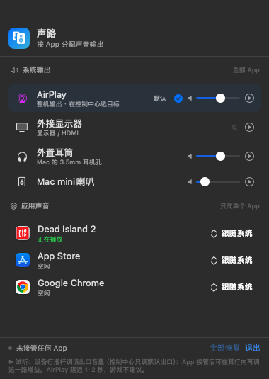
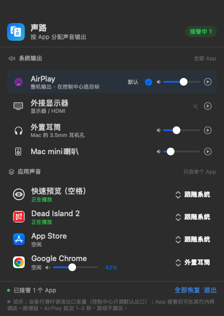

# 声路（SoundPath）

[](https://github.com/Carlapple2025-gif/SoundPath/actions/workflows/ci.yml)

一个常驻 macOS 菜单栏的小工具：**给不同 App 指定不同的声音输出设备**。

比如：Chrome 走「外置耳筒」，系统默认走 AirPlay（HomePod mini），互不打扰。



选中某个 App 的目标设备后，右上角会显示「接管中」，该 App 的胶囊变蓝：



> AirPlay 的具体目标（HomePod / Living Room）由控制中心决定，App 里只显示「AirPlay」这一路。

## 能做什么

| 功能 | 说明 |
| --- | --- |
| 按 App 切换输出 | 每个 App 单独选一个本机输出设备（耳机、内置扬声器、USB 声卡、HDMI…） |
| 一键切换系统输出 | 菜单栏里直接点设备，等同于「系统设置 → 声音 → 输出」 |
| 各出口音量 | 每个输出设备行内都有音量滑杆；控制中心只给默认出口一个滑杆，这里每个出口都能调 |
| 每路增益 | 被接管的 App 行多一条增益滑杆（0–150%），同一个出口上的不同 App 也能分开调 |
| 全部恢复 | 立刻停止接管，所有 App 回到跟随系统 |
| 实时状态 | 显示哪些 App 正在播放、当前接管了几个 |
| 试听 | 每个输出设备行尾的 ▶ 会播一声短音，帮你确认它对应哪个物理出口 |

## 重要限制（先看这里）

1. **AirPlay / HomePod mini 不能作为「单个 App」的输出。**  
   macOS 不允许 AirPlay 设备加入分应用路由所需的聚合设备，App 里也会把 AirPlay 选项置灰。  
   可行的做法是：**整机输出设为 AirPlay**，再把个别 App（如 Chrome）单独分流到耳机。
2. **AirPlay 有 1–2 秒延迟。** 看视频/听音乐时播放器会补偿，但**动作游戏不要用 HomePod**，会音画不同步。游戏建议用耳机或内置扬声器。
3. 分应用路由需要 App **正在运行**，并且先播放一点声音（这样才会出现在列表里）。App 重启后需要重新选一次。
4. 只处理本机输出设备；蓝牙耳机在系统里就是普通输出设备，可以选（延迟取决于耳机）。
   接管期间该 App 的原始输出会被静音（这是改道的前提），停止接管后自动恢复。
5. **音量分两层，别混用。**  
   - 设备行滑杆 = 那个物理出口自己的系统音量（等同于控制中心里给该设备调音量），改动会保留。  
   - App 行滑杆 = 声路转发时乘的**软件增益**（0–150%），叠加在设备音量之上，100% 是原始音量。  
   超过 100% 只能放大已经录到的信号，可能削波失真；想变响优先调设备音量，增益只在需要「这一个 App 小声一点」时用。

## 环境要求

- macOS **14.4 或更新**（用到了 Core Audio Process Tap；本机是 macOS 27）
- Swift 6 工具链（命令行工具即可，不需要完整 Xcode；脚本会优先用 Command Line Tools，即使装了 Xcode 但没同意许可也能构建）
- Apple Silicon / Intel 均可

## 构建与运行

在「终端」里执行：

```bash
git clone https://github.com/Carlapple2025-gif/SoundPath.git
cd SoundPath
bash build.sh
open "dist/声路.app"
```

打通用二进制（Apple Silicon + Intel 都能跑）：

```bash
SOUNDPATH_UNIVERSAL=1 bash build.sh
```

菜单栏右上角会出现「声路」图标（两个小音箱）。

想放到「应用程序」里方便以后打开：

```bash
bash install.sh
```

它会构建（如果还没构建）、复制到 `~/Applications/声路.app` 并启动。

### 正式分发（签名 + 公证）

自己编译出来的 App 是 ad-hoc 签名，**别人下载会被 Gatekeeper 拦**。正式发给别人需要 Apple Developer Program：

1. 按 [docs/RELEASING.md](docs/RELEASING.md) 报名、装 Developer ID 证书、存好公证凭据；
2. 改 `Info.plist` 版本并更新 `CHANGELOG.md`；
3. `SOUNDPATH_NOTARY_PROFILE=soundpath-notary bash release.sh` —— 自动出 universal 包、签名、公证、staple；
4. `bash release.sh --upload` 传到对应的 GitHub Release。

没有证书时 `release.sh` 会直接提示，不会产出半成品。

## 第一次使用

1. 点菜单栏图标，弹出面板。
2. 第一次给某个 App 选设备时，系统会问是否允许「声路」录制其他 App 的音频 —— 点 **允许**。
   - 如果误点了拒绝：系统设置 → 隐私与安全性 → **屏幕与系统音频录制**，把「声路」打开。
3. 让目标 App 播一点声音（这样它才会出现在「应用声音」里）。
4. 点该 App 右侧的「跟随系统」，选目标设备。胶囊变蓝、顶部出现「接管中 1」，就生效了。
5. 不确定哪个设备对应哪个口？点设备行尾的 **▶** 听一声。

### 你的场景怎么配

- 在「系统输出」里把默认输出设为 **AirPlay**。
  → 具体投到哪个 HomePod，macOS 只在**控制中心 → 声音**里选；先在控制中心选好 HomePod mini。
- 让 Chrome 播声音 → 在「应用声音」里把 Chrome 选成 **外置耳筒**。
- 游戏（Dead Island 2 等）不建议走 AirPlay：把系统输出切到**外置耳筒 / 内置扬声器**，游戏跟着系统走。

## 常见问题

**为什么列表里没有“小米耳机”，只有“外置耳筒”？**  
macOS 对 3.5mm 模拟耳机只给通用名字「外置耳筒」，不显示品牌。  
如果耳机插在**显示器**的耳机孔上，Mac 只会看到 HDMI，无法单独切到那副耳机——那是显示器自己的转发，macOS 不知道。把耳机插到 Mac 背面的 3.5mm 孔，或换 USB 声卡 / 蓝牙耳机，才会出现独立设备。

**控制中心只能调默认出口的音量，其他出口怎么办？**  
面板「系统输出」里每个支持软件音量的设备行尾都有滑杆，直接拖就是调那个出口自己的音量，不影响默认出口。  
像 HDMI 显示器这类没有可写音量的出口，行尾只显示一个灰色喇叭图标（鼠标悬停有说明）；需要单独调小时，把对应 App 接管过来，用 App 行的软件增益。

**接管后原来的设备（尤其 HomePod / AirPlay）还在放这个 App 的声音？**  
更新到 **1.0.1** 及以后；1.0.1 把 Tap 静音模式改成了强制静音，修掉了「两边同时响」。升级后退出「声路」再重新打开、重新接管一次即可。

**选了“外置耳筒”，声音却从显示器出来？**  
先确认你动的是「系统输出」还是某个 App 的「跟随系统」：
- 只改单个 App 时，其他声音（例如游戏）仍在系统输出上，所以还会听到显示器。
- 想全部切走，用「系统输出」。
- 点行尾 **▶** 试听；听不到就说明那个物理口没接东西。

**AirPlay / HomePod 不见了？**  
AirPlay 设备只在有活动连接时出现在系统里。先在**控制中心 → 声音**里选 HomePod mini，等它重新出现，「声路」的列表里就会有 AirPlay。macOS 把默认输出切走后，AirPlay 会话可能会断开。

**列表里没有某个 App？**  
先让它播放声音；这里只显示普通前台 App（菜单栏小工具、后台守护进程不显示）。

**选了设备但没声音？**  
看面板上方的红色提示。最常见是权限被拒，其次目标设备被拔掉/切换了。点「全部恢复」再重试。

**AirPlay 选项是灰的？**  
正常，见上面的限制 1。

**重新编译后又问权限？**  
本地 ad-hoc 签名每次编译指纹会变，macOS 会当成新 App。把系统设置里旧的「声路」开关关掉再打开，或重新允许即可。

**想彻底退出？**  
面板右下角「退出」。退出或崩溃时 Core Audio 会自动销毁 Tap，声音恢复正常。

## 原理（简单版）

1. 用 Core Audio 的 **Process Tap** 捕获指定 App 的音频，并把该 App 的原始输出**强制静音**（`.muted`）。
   接管期间源 App 不会再从原设备出声；停止接管或退出时 Tap 销毁，原输出自动恢复。
2. 创建一个**私有聚合设备**：目标输出设备提供时钟，Tap 作为输入。
3. 在设备的 IO 回调里把 Tap 的 Float32 采样复制到目标设备的输出缓冲，完成「改道」；
   复制时按该路增益做逐块平滑（滑块拖动不会爆音）。
4. 停止时销毁聚合设备和 Tap，App 自动回到原输出。
5. 设备音量走 Core Audio 的 `kAudioDevicePropertyVolumeScalar`（输出 scope），
   与系统音量是同一套数值，所以对每个出口都能单独调。

所有处理都在本机内存中完成，不联网、不录音、不落盘。

## 开发 / 调试

```bash
# 普通窗口预览（方便调 UI）
"dist/声路.app/Contents/MacOS/SoundPath" --preview

# 命令行验证接管链路（不弹 UI）
"dist/声路.app/Contents/MacOS/SoundPath" --route-test "Dead Island 2" "Mac mini喇叭"

# 验证链路并施加 50% 增益：--route-test <App> <设备> <持续秒数> <增益>
"dist/声路.app/Contents/MacOS/SoundPath" --route-test "Dead Island 2" "Mac mini喇叭" 3 0.5

# 自测转发增益的数学（不需要录音权限，返回 0 即通过）
"dist/声路.app/Contents/MacOS/SoundPath" --mixer-test

# 渲染界面截图
"dist/声路.app/Contents/MacOS/SoundPath" --snapshot docs/preview.png
```

## 文件结构

仓库根目录结构：

```
Package.swift                  SwiftPM 工程
Sources/SoundPath/
  SoundPathMain.swift          菜单栏入口、预览/自测模式
  ContentView.swift            面板 UI
  SoundPathStore.swift         状态与路由管理
  AudioDevices.swift           输出设备枚举 / 系统默认切换
  AppProcesses.swift           App 进程扫描与分组
  AppAudioRouter.swift         Tap + 聚合设备 + 实时转发（含每路软件增益）
  TestTonePlayer.swift         设备试听音
  CoreAudioSupport.swift       Core Audio 封装（含每设备音量读写）
release.sh                     正式发版：通用包 + 签名 + 公证
docs/RELEASING.md              Apple Developer / 公证 / 发版步骤
Resources/Info.plist           LSUIElement、音频捕获权限说明
Resources/AppIcon.icns         图标
build.sh / install.sh          构建 / 安装
tools/make_icon.swift          图标生成脚本
```

## 更新日志与许可证

- 更新日志：[CHANGELOG.md](CHANGELOG.md)
- 许可证：[MIT](LICENSE)（Copyright © 2026 Carlapple2025-gif）

## 卸载

1. 面板里点「退出」。
2. 删除 `~/Applications/声路.app`（或 `dist/声路.app`）。
3. 可选：系统设置 → 隐私与安全性 → 屏幕与系统音频录制，移除「声路」。
